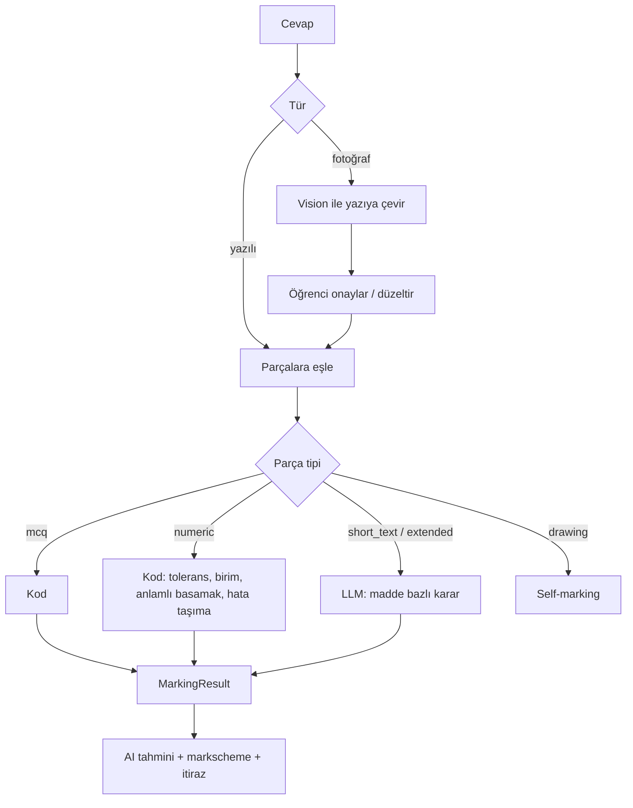

# AI_PIPELINE

> **Durum: ONAYLANDI** (2026-10-11, proje sahibi). Değişiklikler [DECISIONS.md](DECISIONS.md) üzerinden işlenir.
> Eşik değerleri öneridir; M0'da kendi ölçüm setinizde kalibre edilmeden bağlayıcı değildir.

## 1. İlkeler

1. Akış sabittir ve veritabanındaki durum makinesi yönetir. Agent, araç kullanan model ve LLM orkestratör yok.
2. Her LLM adımı tek çağrıdır; çıktı sağlayıcının yapılandırılmış çıktı özelliğiyle şemaya zorlanır ve Pydantic ile yeniden doğrulanır.
3. Bir modelin "doğru" demesi doğrulama değildir.
4. Üretim adımı kaynak soruyu görmez.
5. Her adım idempotenttir, bütçe tavanına ve deneme sınırına tabidir.
6. Çeşitlilik temperature ile değil, Blueprint ve parametre çeşitliliğiyle sağlanır (güncel modellerde sampling parametreleri kısıtlı).

## 2. Adımlar: kod mu, model mi

| # | Adım | Tür | Girdi | Çıktı | Başarısızlıkta |
|---|---|---|---|---|---|
| 0 | Biçim profili (bir kerelik, sürümlü) | İnsan + AI yardımı | Sınav belgeleri, uzman bilgisi | Biçim profili; soru metni içermez | Uzman onayı olmadan kullanılmaz |
| 1 | Blueprint yazımı | İnsan, ya da LLM önerir + insan onaylar | Müfredat düğümü, biçim profili | Blueprint | Uzman reddeder |
| 2 | Blueprint kontrolü | Kod | Blueprint | Şema ve müfredat düğümü geçerli; kapsam dengesi | Düzeltmeye döner |
| 3–5 | *(Askıda, D-46)* Orijinal soru alma, çıkarma kontrolleri, sınıflandırma | — | — | — | Yazılı lisans olmadan çalışmaz |
| 6 | Üretim | LLM (orta; zor tipte üst) | Yalnızca Blueprint | Soru, parçalar, markscheme, formül zinciri, şekil tarifi | Yeniden dene |
| 7 | Deterministic kontroller | Kod | Aday | Rapor | Gerekçeyle 6'ya dön |
| 8 | Şekil üretimi | Kod (şablon) | Şekil tarifi, parametreler | SVG, alt metin | Aday reddi |
| 9 | Kör çözüm | LLM (diğer sağlayıcı) | Yalnızca soru | Cevaplar | Uyuşmazlık → ret ya da insan |
| 10 | Eleştirmen | LLM | Soru, markscheme, Blueprint | Bulgular | Kritik bulgu → 6'ya dön |
| 11 | Benzerlik | Embedding + kod | Aday | Skor, en yakın komşular | Eşik üstü → ret |
| 12 | İnsan incelemesi | İnsan | Aday + tüm raporlar | Karar | — |
| 13 | Yayın | Kod | Onaylı sürüm | Yayınlanmış sürüm | — |

Klasik ML yok: sınıflandırma kapalı listeden seçimdir ve küçük LLM ile yapılır; etiketli veri biriktiğinde ucuz bir sınıflandırıcıya
geçiş değerlendirilebilir (ertelendi).

## 3. İçerik alma (askıda, D-46)

> Bu bölüm, bir sınav kurumundan yazılı lisans alınırsa kullanılacak tasarımı anlatır. Şu an hiçbir parçası uygulanmaz ve çalıştırılmaz.

**Yöntem (D-15):** sayfa görüntüsü vision modele verilir; çıktı soru şemasındadır (kök, parçalar, puanlar, seçenekler, matematik LaTeX,
şekil bölgeleri). M0'da 50 sayfalık örnek sette vision model ile Docling karşılaştırılır; çıkarma bir arayüzün arkasındadır.

**Kod kontrolleri:**

- Şema geçerliliği; her matematik düğümü KaTeX'te render oluyor.
- Parça puanları toplamı kâğıtta yazan toplamla eşit.
- MCQ'da seçenek sayısı beklenen sayıda; parça etiketleri sıralı ve eksiksiz.
- Her şekil bölgesi bir `figure` düğümüne bağlı; kırpım boş değil.
- **Çift çıkarım:** aynı sayfa iki bağımsız çağrıyla çıkarılır; metin ve LaTeX normalize edilip karşılaştırılır. Fark varsa insan kuyruğu.

**İnsan kontrolü:** işaretlenenler ve rastgele örneklem. Örneklemdeki hata oranı izlenir; eşik aşılırsa örneklem oranı artar.

**Gösterim:** insan doğrulayana kadar öğrenciye orijinal sayfa kırpımı gösterilir (`display_mode = page_crop`).

**Talimat enjeksiyonu:** PDF'teki metin veridir; sistem talimatından ayrı alanda verilir ve çıktı şemayla sınırlıdır.

## 4. Biçim profili ve Blueprint (adım 0–2)

**Biçim profili (D-44).** Sınav belgeleri yalnızca şunu öğrenmek için incelenir: bir soru nasıl görünür, nasıl yapılandırılır ve bilimsel
olarak eksiksiz olması için neleri taşır. Profil kendi cümlelerimizle yazılır ve şunları içerir:

- Bölüm yapısı: soru türleri, soru ve parça sayıları, puan aralıkları, süre, hesap makinesi ve veri kitapçığı kullanımı.
- Parça düzeni: etiketleme, puan gösterimi, komut sözcükleri ve her birinin beklediği cevap türü.
- Gösterim kuralları: birim yazımı, anlamlı basamak, sembol ve değişken biçimi, tablo ve grafik düzeni.
- Şekil türleri: hangi konularda hangi tür şema ya da grafik kullanılır.
- Markscheme düzeni: madde türleri, alternatif cevap ve hata taşıma gösterimi.
- Eksiksizlik ölçütleri: verilen büyüklükler birimli mi, varsayımlar belirtilmiş mi, tek cevap var mı, puan emeğe uygun mu.

Profil soru metni, sayı, senaryo ya da şekil içermez. İnceleme sırasında çıkarılan geçici dosyalar oturum sonunda silinir.

**Blueprint (D-45).** Şema: [DATA_ARCHITECTURE.md](DATA_ARCHITECTURE.md) §5. Kaynağı müfredat düğümü ve biçim profilidir:

- Uzman doğrudan yazar; ya da
- LLM, müfredat düğümü + biçim profili + kapsam hedeflerinden Blueprint önerir ve uzman onaylar. Model hiçbir sınav sorusu görmez.

Kod kontrolü: şema geçerliliği, müfredat düğümünün varlığı, biçim profiliyle uyum (parça sayısı ve puan aralığı) ve havuzdaki konu, tür
ve zorluk dağılımının dengesi.

## 5. Üretim (adım 6)

Girdi yalnızca Blueprint, programın sınav biçimi ve etiket sözlüğü, izinli formül fonksiyonları, kullanılabilir şekil şablonları ve
sabit tablosudur.

Çıktı tek bir yapılandırılmış nesnedir:

- Kök ve parça gövdeleri (blok şeması; verilen büyüklükler `quantity` düğümü olarak)
- Parça başına cevap tanımı ve markscheme maddeleri
- Formül zinciri (parametreler, adımlar, cevap bağları, parametre aralıkları)
- Şekil tarifi (şablon kimliği + parametre bağları) ya da "şekil yok"
- MCQ'da çeldiriciler ve her çeldiricinin temsil ettiği yanılgı

Model kademesi (D-30): varsayılan orta kademe. İki denemede kontrolleri geçemeyen aday ya da "zor" işaretli tipler üst kademeye
yükseltilir. Toplu (batch) mod varsayılandır; incelemecinin "yeniden üret" isteği anında çalışır.

## 6. Deterministic kontroller (adım 7)

Her kontrolün önem derecesi vardır: **kritik** (yayını bloklar) ya da **uyarı** (incelemeciye gösterilir).

| Kontrol | Derece | Araç |
|---|---|---|
| Şema ve blok yapısı geçerli | Kritik | Pydantic |
| Her matematik düğümü render oluyor | Kritik | KaTeX |
| Formül zinciri yalnızca izinli öğeler içeriyor ve süre sınırında hesaplanıyor | Kritik | Yorumlayıcı |
| Her adımın birimi beyan edilen birimle boyutça tutarlı | Kritik | Pint |
| Beyan edilen cevap, zincirin sonucuyla tolerans içinde eşit | Kritik | Yorumlayıcı |
| Gövdedeki her `quantity`, zincirdeki parametreyle değer ve birim olarak eşit | Kritik | Kod |
| Zincirdeki her parametre gövdede veriliyor ya da sabit tablosunda | Kritik | Kod |
| Parça ve madde puanları toplamı tutuyor | Kritik | Kod |
| MCQ: tam bir seçenek doğru; çeldiriciler birbirinden ve doğrudan farklı (sayısalda tolerans dışı) | Kritik | Kod |
| Cevap anlamlı basamak kuralına uyuyor | Uyarı | Kod |
| Parametreler beyan edilen aralıkta ve fiziksel olarak makul | Uyarı | Kod |
| Şekil tarifindeki parametreler zincirdekilerle aynı | Kritik | Kod |
| Blueprint'teki yapı (parça sayısı, command term, puan) korunmuş | Kritik | Kod |

Başarısız kontrolün kodu ve gerekçesi üretim adımına geri verilir. Deneme sınırı aşılırsa aday `failed_final` olur.

**Uygulanamaz durumlar:** uzun açıklamalı parçalarda sayısal kontroller "uygulanamaz" döner; bu parçalar iki incelemeci kuralına girer.

## 7. Kör çözüm ve eleştirmen (adım 9–10)

**Kör çözüm:** üretici modelden farklı sağlayıcının modeli; yalnızca öğrencinin göreceği soruyu ve izinli sabitleri görür. Sayısal
parçalarda sonucu zincirin sonucuyla karşılaştırılır.

| Durum | Sonuç |
|---|---|
| Sayısal parçaların hepsi uyuşuyor | Devam |
| Uyuşmazlık | Bir kez daha çözdürülür; yine uyuşmazsa aday reddedilir ya da "çözüm tartışmalı" işaretiyle insana gider |
| Çözücü "bilgi eksik / belirsiz" diyor | Kritik bulgu; üretime geri |

**Eleştirmen:** soruyu, markscheme'i ve Blueprint'i görür; görevi iyileştirmek değil geçersiz kılmaktır. Kontrol listesi:
eksik bilgi, birden çok geçerli yorum, fiziksel varsayım eksikliği, markscheme ile soru çelişkisi, puan-emek dengesi, müfredat dışı
bilgi gereksinimi, command term'e uygunluk, dil netliği. Her bulgu derece ve gerekçe taşır.

**Sınır:** iki model aynı belirsiz soruyu aynı şekilde yanlış anlayabilir; formül zinciri yanlış fizik içerip yine de kendi içinde tutarlı
olabilir. Bu yüzden insan incelemesi kaldırılmaz.

## 8. Benzerlik ve özgünlük (adım 11)

- Embedding ile en yakın komşular (kendi soru havuzumuzda) + kelime dizisi örtüşmesi + yapısal imza (parametre adları, formül
  zincirinin biçimi, bağlam etiketi).
- Üç bölge: **yüksek** → otomatik ret; **orta** → incelemeciye en yakın komşularla birlikte gösterilir; **düşük** → devam.
- Eşikler M0'da etiketli soru çiftleriyle kalibre edilir. PDF'teki 0.82 / 0.92 değerleri başlangıç tahminidir, bağlayıcı değildir.
- **Ezber riski:** üretici model, eğitim verisinden bildiği gerçek bir sınav sorusunu yeniden üretebilir ve elimizde karşılaştıracak
  kaynak havuzu yoktur (D-44). İnceleme formunda "bilinen bir sınav sorusuna benziyor mu" sorusu zorunludur; evet ise aday reddedilir.

## 9. İnsan incelemesi (adım 12)

İnceleme ekranı: öğrencinin göreceği gösterim, markscheme, formül zinciri ve hesaplanan değerler, tüm kontrol raporları, kör çözüm
sonucu, eleştirmen bulguları, en yakın benzer sorular, model ve prompt sürümü.

- Kararlar: onay, düzeltip onay (yeni sürüm), yeniden üret (gerekçeyle), ret.
- Gerekli onay: kodla doğrulanmış tiplerde 1; uzun açıklamalı ve "kodla doğrulanamaz" tiplerde 2 (D-18).
- Rastgele ikinci inceleme: onaylanan soruların bir örneklemi ikinci incelemeciye körlemesine gider; uyum oranı izlenir.
- İş dağıtımı: konu uzmanlığına ve yüke göre; bir incelemeci kendi düzelttiği sürümün ikinci onayını veremez.
- Backend, kritik kontrolü kalan sürümün yayınını reddeder; arayüz kararından bağımsızdır.

## 10. Hata yönetimi ve maliyet

| Konu | Kural |
|---|---|
| Geçici sağlayıcı hatası | Üstel geri çekilmeyle yeniden dene; sınır sonrası `failed_retryable` |
| Şemaya uymayan çıktı | Bir kez yeniden dene; yine uymazsa adım başarısız |
| Model reddi (refusal) | Kayda geçir; diğer sağlayıcıya geçiş yalnızca kaynak içerik içermeyen adımlarda otomatik |
| Deneme sınırı | Üretim için aday başına sınır (öneri: 3) |
| Bütçe | Çalışma başına ve günlük tavan; aşımda hat durur ve uyarı gider |
| Önbellek | Aynı (adım, prompt sürümü, girdi özeti) için sonuç yeniden kullanılır |
| Kill switch | Adım türü bazında; kaynak içerik işleyen adımlar tek ayardan kapatılır |
| Kayıt | Her çağrı: sağlayıcı, model, prompt sürümü, token, maliyet, süre |

## 11. Model rolleri

Üç aday sağlayıcı (Anthropic, OpenAI, Google); rol ataması M0 ölçümüyle yapılır (D-28). Aşağıdaki tablo hipotezdir.

| Rol | Kademe | Kısıt |
|---|---|---|
| Blueprint önerisi | Orta | Sınav sorusu görmez |
| *(Askıda)* İçerik alma, sınıflandırma | — | Lisans ve no-retention koşulu |
| Üretim | Orta; zor tipte üst | — |
| Kör çözüm | Orta; üreticiden farklı sağlayıcı | — |
| Eleştirmen | Orta ya da üst | — |
| Embedding | Sağlayıcı API'si | Yalnızca kendi sorularımız |
| Fotoğraf çevirisi | Orta (vision) | Öğrenci verisi; koşullar [SECURITY.md](SECURITY.md) |
| Puanlama | Küçük ya da orta; ölçümle | Öğrenci verisi |

Fiyat ve veri saklama koşullarının doğrulama durumu: [TECH_STACK.md](TECH_STACK.md) §LLM. Not: no-retention çoğu sağlayıcıda varsayılan
değildir, başvuru ve onay gerektirir; bazı modeller kapsam dışıdır.

## 12. Öğrenci cevabı puanlama

- **Madde bazlı:** model her `MarkPoint` için "verildi / verilmedi", cevaptan alıntı ve kısa gerekçe döndürür. Toplamı kod hesaplar;
  model toplam puan üretmez.
- **Hata taşıma:** `MarkingPolicy` izin veriyorsa, öğrencinin önceki parçadaki değeri formül zincirine parametre olarak verilir ve sonraki
  adımın o değerle beklenen sonucu hesaplanır.
- **Enjeksiyon:** öğrenci cevabı veri alanındadır; çıktı şeması yalnızca madde kararlarını kabul eder; verilen puan madde puanını aşamaz.
- **Kimlik:** modele ad, e-posta ya da hesap kimliği gitmez.
- **Kota:** Abonelik 2'de aylık tavan (D-26); sayaç `UsageQuota`.
- **Kapalı dönem:** öğretmenler AI puanlarının bir örneklemini onaylar ya da düzeltir; bu veri uyum ölçümüdür.

## 13. Ölçüm setleri ve eşikler

| Set | İçerik | Ölçü | Önerilen ilk hedef |
|---|---|---|---|
| Çıkarma seti | 50 sayfa, elle doğrulanmış | Formül birebir doğruluk; yapı doğruluğu; sayfa başı maliyet | M0'da belirlenir |
| Sınıflandırma seti | Uzman etiketli ~300 soru | Birincil düğüm doğruluğu; müfredat dışı tespiti | M0'da belirlenir |
| Hata ekilmiş set | Bilerek bozulmuş sorular (yanlış cevap, birim, eksik veri, iki doğru seçenek, belirsiz ifade) | Hata türüne göre yakalama oranı | Sayısal ve birim hatalarında tama yakın; belirsizlikte ölçülür |
| Üretim seti | Sabit Blueprint listesi | İncelemeci onay oranı; yayınlanan soru başı toplam maliyet | İzlenir; düşüş yayın engeli |
| Benzerlik seti | Etiketli soru çiftleri | Eşik başına yanlış ret ve kaçırma | Eşikler buradan |
| Puanlama seti | Öğretmen puanlı gerçek cevaplar (~200, büyür) | Madde bazlı uyum; toplamda ±1 puan içinde oran | M4'te belirlenir; genel erişim kapısı |

Hedeflerin çoğu bilinçli olarak boş: ölçmeden sayı uydurmak yanlış güven verir.

## 14. Prompt ve model yönetimi

- Promptlar depoda dosyadır; her değişiklik `prompt_version` üretir.
- Yeni prompt ya da model sürümü, ilgili ölçüm setinde çalışır ve yürürlükteki sürümden kötü değilse etkinleşir (D-36).
- Etkin sürüm ortam ayarıdır; geri dönüş tek değişikliktir.
- Sağlayıcı bir modeli emekliye ayırdığında aynı kapıdan geçen yeni model atanır.
- Üretim ve ölçüm çağrıları ürünün API anahtarlarıyla yapılır; geliştirme aboneliğiyle karışmaz.
