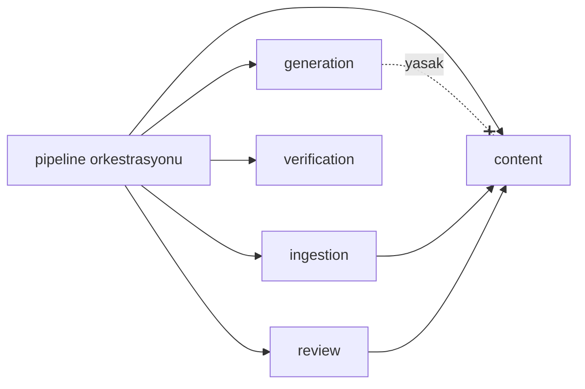

# API_DESIGN

> **Durum: ONAYLANDI** (2026-10-11, proje sahibi). Değişiklikler [DECISIONS.md](DECISIONS.md) üzerinden işlenir.
> Uç nokta listesi gösterim amaçlıdır; kesin sözleşme her dilimde OpenAPI olarak yazılır ve dondurulur.

## 1. Genel kurallar

| Konu | Kural |
|---|---|
| Biçim | REST, JSON, OpenAPI 3.1. TypeScript istemcisi şemadan üretilir; elle istemci kodu yazılmaz |
| Sürüm | Yol ön eki `/v1`. Geriye dönük uyumsuz değişiklik yeni sürümdür |
| Kimlik | Identity provider'ın imzalı token'ı `Authorization: Bearer`; API her istekte doğrular |
| Yetki | Tek politika katmanı, varsayılan ret. Her uç nokta gerekli rolü ve kapsamı beyan eder |
| Hata | `application/problem+json` (RFC 9457): `type`, `title`, `status`, `detail`, `code`, alan hataları |
| Sayfalama | İmleç tabanlı: `?cursor=&limit=`; yanıt `next_cursor` |
| İdempotency | Yan etkili POST'larda `Idempotency-Key` başlığı (cevap gönderme, ödeme, yayın) |
| Zaman | ISO 8601, UTC |
| Kimlikler | Ön ekli, sıralanabilir opak kimlikler (ör. `q_…`, `qv_…`, `att_…`) |
| Hız sınırı | Hesap ve IP bazında; `429` + `Retry-After` |
| Önbellek | Yayınlanmış soru sürümü: değişmez, uzun süreli önbellek başlığı; hak kısıtlı içerik önbelleklenmez |
| Uzun işler | `202 Accepted` + iş kaynağı; istemci durumu sorgular |

## 2. Modüller ve bağımlılık kuralları

Kod düzeni modül başınadır; her modül dışarıya bir servis arayüzü ve DTO'lar açar. Başka modülün tablolarına ve iç koduna erişilmez.

| Modül | Sorumluluk | Bağımlı olabileceği modüller |
|---|---|---|
| `identity` | Kullanıcı, token doğrulama, yaş bandı | — |
| `organizations` | Kurum, üyelik, roller | `identity` |
| `rights` | Rights kayıtları, izin sorguları, kill switch *(kill switch henüz yok)* | — |
| `entitlements` | Plan, entitlement, kota, rıza kuralları | `identity`, `organizations` |
| `audit` | Değiştirilemez olay kaydı | — |
| `syllabus` | Program, ders, müfredat ağacı, sınav biçimi, puanlama politikası *(puanlama politikası henüz yok)* | — |
| `content` | Soru, sürüm, parça, madde, asset, yayın, erişim politikası | `syllabus`, `rights`, `entitlements`, `audit` |
| `ingestion` | Kaynak belge, sayfa, çıkarma | `content`, `rights`, `llm`, `verification` |
| `generation` | Blueprint'ten aday üretimi | `syllabus`, `llm` — **`content` yasak** |
| `verification` | Formül yorumlayıcısı, kod kontrolleri, kör çözüm, eleştirmen, benzerlik | `llm`, `syllabus` |
| `review` | İnceleme kuyrukları, kararlar, ikinci inceleme | `content`, `verification`, `audit` |
| `exams` | Deneme tanımı ve oluşturma | `content`, `syllabus` |
| `attempts` | Oturum, cevap, süre | `content`, `exams`, `entitlements` |
| `marking` | Kod ve AI puanlama, itiraz | `attempts`, `content`, `verification`, `llm`, `entitlements` |
| `analytics` | Performans özetleri | `attempts`, `syllabus` |
| `llm` | Sağlayıcı adapter'ı, çağrı kaydı, önbellek, bütçe | `rights` (no-retention kısıtı) |

Kurallar CI'da import denetimiyle zorlanır. En kritik kural: `generation` → `content` yasağı. Üretim hattını bir üst katman
(`pipeline` orkestrasyonu, worker içinde) birleştirir: Blueprint'i `ingestion`/`content` tarafından alır, `generation`'a DTO olarak verir,
sonucu `content`'e yazar.



## 3. Kaynak grupları

### 3.1 Öğrenci

| Yöntem | Yol | Açıklama |
|---|---|---|
| GET | `/v1/me` | Profil, roller, entitlement, kota durumu |
| GET | `/v1/programs/{program}/subjects/{subject}/syllabus` | Müfredat ağacı |
| GET | `/v1/questions` | Filtreli liste (konu, bölüm, seviye, tip); yalnızca erişilebilir olanlar |
| GET | `/v1/question-versions/{id}` | Hazır soru dokümanı; markscheme ve cevaplar entitlement'a ve cevaplanmış olmasına göre |
| POST | `/v1/attempts` | Serbest çalışma ya da deneme başlat |
| GET | `/v1/attempts/{id}` | Durum; kalan süre sunucudan |
| POST | `/v1/attempts/{id}/responses` | Parçaya cevap (seçenek, sayı+birim, LaTeX, metin) |
| POST | `/v1/attempts/{id}/responses/{rid}/photo` | Fotoğraf için imzalı yükleme adresi iste |
| GET | `/v1/responses/{rid}/transcript` | Fotoğraf çevirisi |
| PUT | `/v1/responses/{rid}/transcript` | Çeviriyi onayla ya da düzelt; puanlama bundan sonra başlar |
| POST | `/v1/attempts/{id}/submit` | Denemeyi bitir |
| GET | `/v1/responses/{rid}/marking` | Puanlama sonucu (madde bazlı) |
| POST | `/v1/marking-results/{id}/appeals` | İtiraz |
| GET | `/v1/me/analytics` | Konu bazlı performans |

Cevap gösterimi kuralı: markscheme ve doğru cevap, öğrenci o parçaya cevap verdikten sonra ya da deneme teslim edildikten sonra döner;
sunucu zorlar.

### 3.2 Açık (girişsiz)

| Yöntem | Yol | Açıklama |
|---|---|---|
| GET | `/v1/public/subjects/{subject}/topics` | Konu sayfaları için |
| GET | `/v1/public/question-versions/{id}` | Yalnızca ücretsiz kademedeki `generated` sorular |

`source_original` içerik hiçbir açık uç noktadan dönmez.

### 3.3 İçerik ve inceleme (personel)

| Yöntem | Yol | Açıklama |
|---|---|---|
| POST | `/v1/admin/source-documents` | Kaynak yükle (rights kaydı zorunlu) |
| POST | `/v1/admin/pipeline-runs` | İçerik alma ya da üretim başlat |
| GET | `/v1/admin/pipeline-runs/{id}` | Adımlar, maliyet, hatalar |
| GET | `/v1/admin/review/queue` | İnceleme kuyruğu (tip, konu, öncelik) |
| GET | `/v1/admin/review/items/{id}` | Aday + raporlar + kaynak sayfa bölgesi |
| POST | `/v1/admin/review/items/{id}/decisions` | Onay / düzeltme / yeniden üret / ret |
| PUT | `/v1/admin/question-versions/{id}` | Taslak sürümü düzenle (yalnızca `draft`, `needs_fix`) |
| POST | `/v1/admin/question-versions/{id}/publish` | Yayınla; kritik kontrol varsa `409` |
| POST | `/v1/admin/questions/{id}/withdraw` | Geri çek |
| POST | `/v1/admin/questions/withdraw-by-lineage` | Bir kaynak belgeden türeyen tüm soruları geri çek |
| GET | `/v1/admin/appeals` | İtiraz kuyruğu |

### 3.4 Platform yönetimi

Rights kayıtları, kill switch, plan ve entitlement tanımları, rıza kural tablosu, rol atamaları, prompt sürümü etkinleştirme.
Hepsi `platform_admin`, hepsi audit log'a yazılır.

### 3.5 Ödeme (M6)

Ödeme oturumu başlatma, veli için ödeme bağlantısı üretme, sağlayıcı webhook'u. Webhook imzası doğrulanır ve işlem idempotenttir.

## 4. Hata sözleşmesi

```json
{
  "type": "https://errors.example/question-not-publishable",
  "title": "Question version cannot be published",
  "status": 409,
  "code": "critical_checks_failed",
  "detail": "2 critical verification checks failed.",
  "errors": [{ "check": "answer_matches_chain", "part": "b" }]
}
```

Kararlı `code` değerleri istemcinin dallandığı tek alandır. Yetkisiz erişimde var olmayan kaynakla aynı yanıt döner (`404`), kaynağın
varlığı sızdırılmaz.

## 5. Uzun işler

Puanlama, içerik alma ve üretim kuyruğa girer. Model: istek `202` ve iş kimliği döner; istemci iş kaynağını sorgular. Gerçek zamanlı
kanal (WebSocket, SSE) MVP'de yok; bekleme süresi ölçülüp gerekirse eklenir.

## 6. Uyum ve değişiklik yönetimi

- OpenAPI şeması depoda tutulur; değişiklik pull request'te görünür.
- CI: şemadan üretilen istemci güncel mi; geriye dönük uyumsuz değişiklik var mı.
- Sözleşme, alt ajanlara dağıtılmadan önce ana oturum tarafından dondurulur ([DEVELOPMENT_WORKFLOW.md](DEVELOPMENT_WORKFLOW.md)).
