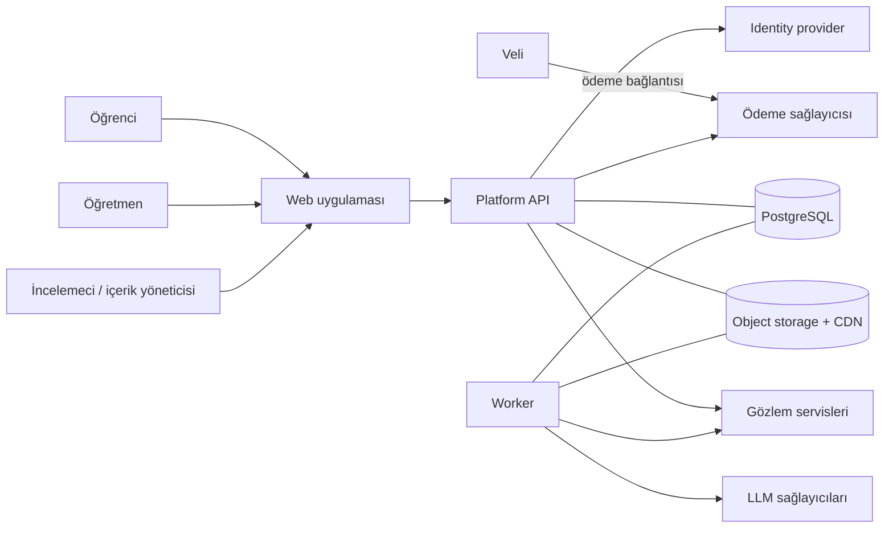
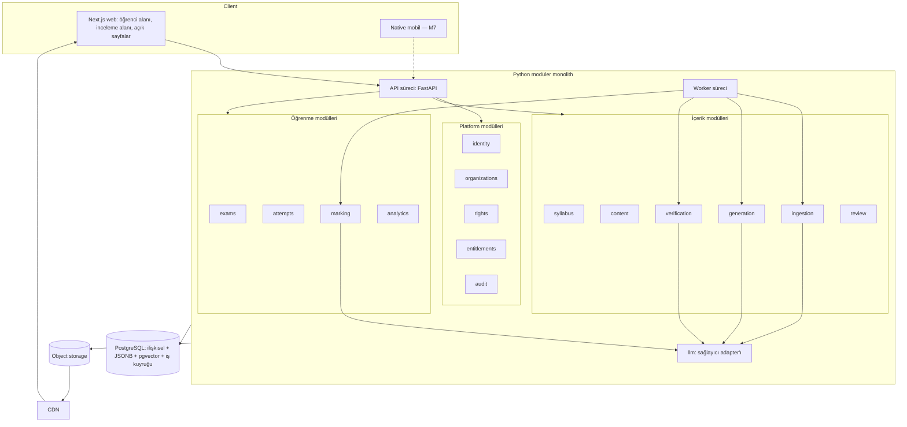
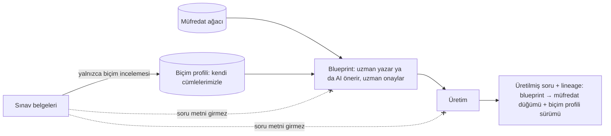
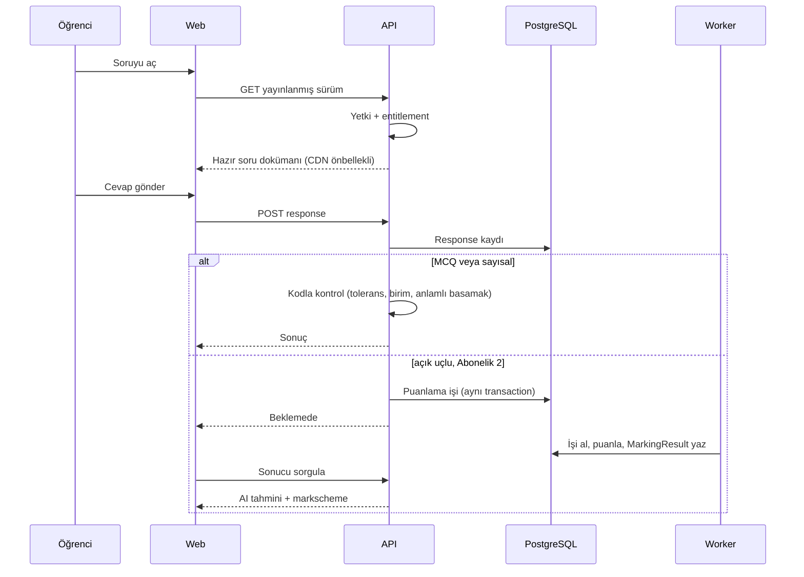
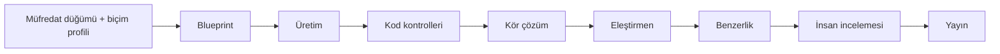

# ARCHITECTURE

> **Durum: ONAYLANDI** (2026-10-11, proje sahibi). Değişiklikler [DECISIONS.md](DECISIONS.md) üzerinden işlenir. Kararların kaynağı: [DECISIONS.md](DECISIONS.md).
> Bu belge sistemin üst seviye yapısını anlatır. Ayrıntılar ilgili belgelerdedir.

## 1. Amaç ve kapsam

Uluslararası sınavlara hazırlanan öğrenciler için web (sonra mobil) soru bankası, deneme sınavı ve AI destekli geri bildirim platformu.
İlk program **IB Diploma**, ilk ders **Physics**. Veri modeli başka program ve derslere genişleyecek şekilde tasarlanır; davranış yalnızca
Physics için yazılır (D-37).

Sistem iki alt sistemden oluşur:

| Alt sistem | Kullanıcı | Karakter |
|---|---|---|
| **Öğrenci ürünü** | Öğrenci, öğretmen | Etkileşimli, düşük gecikme, okuma ağırlıklı |
| **İçerik fabrikası** | İncelemeci, içerik yöneticisi | Asenkron, uzun süren işler, insan onaylı |

İkisi aynı kod tabanında, aynı veritabanında yaşar; ayrım modül sınırları ve süreç türüyle (API / worker) yapılır.

## 2. Mimari ilkeler

1. **LLM üretir, kod doğrular, insan yayınlar.** Hiçbir LLM çıktısı tek başına doğruluk kanıtı sayılmaz.
2. **Cevap koddan gelir.** Sayısal cevaplar, ara değerler ve diyagram sayıları bildirimsel formül zincirinden hesaplanır.
3. **LLM orkestratör değildir.** Akış veritabanındaki açık durum makinesidir; her LLM adımı tek, yapılandırılmış bir çağrıdır. Agent yok.
4. **Sınav belgeleri yalnızca biçim öğretir.** Üretim adımı yalnızca Blueprint alır; Blueprint müfredattan yazılır, bir sınav sorusundan değil (D-44, D-45).
5. **Fail-closed haklar.** Geçerli `rights` kaydı olmayan içerik işlenmez, gösterilmez.
6. **Tek gösterim yolu.** İncelemecinin onayladığı görüntü ile öğrencinin gördüğü görüntü aynı bileşenden çıkar.
7. **Değişmez sürümler.** Yayınlanmış soru sürümü değişmez; düzeltme yeni sürümdür.
8. **Kurallar kodla zorlanır.** Değişmez kurallar test ve CI denetimidir, yalnızca yazılı talimat değil.
9. **Gerekçesiz karmaşıklık yok.** Microservice, event sourcing, CQRS, Temporal, agent çerçeveleri: somut tetikleyici oluşana kadar yok.

## 3. Sistem bağlamı

## 4. Bileşenler

Modül sorumlulukları ve bağımlılık kuralları: [API_DESIGN.md](API_DESIGN.md) §2.

### Süreçler

| Süreç | Görev | Ölçekleme |
|---|---|---|
| API | HTTP istekleri, yetki, okuma/yazma, iş kuyruğa ekleme | Durumsuz, yatay |
| Worker | İçerik alma, üretim, doğrulama, puanlama, toplu işler | Kuyruk derinliğine göre |
| Formül yorumlayıcısı | Worker'ın başlattığı ayrı alt süreç; süre ve bellek sınırlı | İş başına |

LLM anahtarları yalnızca worker sürecinde bulunur.

## 5. İçerik kökeni sınırı

Tek `Question` varlığı vardır; `origin` alanı kökeni belirtir (D-22).

| Köken | Kimler görür | AI üretimine girdi olur mu |
|---|---|---|
| `source_original` (sınav kurumunun orijinal sorusu) | **Yalnızca sahibin kişisel kitaplığı (D-47):** tek hesap görür; sayfa görüntüsü olarak; başka hiçbir kullanıcıya, yazılı lisans olmadan, gösterilmez | Hayır (D-44) |
| `generated` (AI üretimi, insan onaylı) | Entitlement'a göre herkes | — |
| `authored` (ileride: elle yazılmış) | Entitlement'a göre | — |

Sınır iki noktada zorlanır:

1. **Erişim:** tüm öğrenci sorguları `content` modülünün tek politika katmanından geçer. Test: kurum dışı hesap `source_original` soruya erişemez.
2. **Üretim:** `generation` modülü `content` tablolarını import edemez; yalnızca `Blueprint` DTO'su alır. CI import kuralı.

**Biçim profili** bir sınav bölümünün korunmayan özelliklerini anlatır: soru türleri, parça ve puan düzeni, komut sözcükleri, birim ve
gösterim kuralları, şekil türleri, markscheme düzeni ve bir sorunun bilimsel olarak eksiksiz sayılması için taşıması gereken öğeler.
Soru metni, sayı ya da senaryo içermez. Uzmanlarca onaylanır ve sürümlüdür.

`source_original` kökeni veri modelinde durur ama kapalıdır: bir sınav kurumundan yazılı lisans alınırsa rights kaydıyla açılabilir.

## 6. Temel akışlar

### 6.1 Öğrenci soru çözer

### 6.2 İçerik fabrikası

Ayrıntı: [AI_PIPELINE.md](AI_PIPELINE.md).

## 7. MVP ve sonrası

| Alan | MVP (M0–M6) | Sonra |
|---|---|---|
| Program / ders | IB Diploma Physics | IB'de ikinci ders; ardından diğer sınav kurumları |
| İstemci | Responsive web | Native mobil (M7) |
| Soru tipleri | Paper 1A, Paper 2, Paper 1B, uzun cevap (sırayla) | Program bazlı yeni tipler |
| Cevap değerlendirme | Kod (MCQ, sayısal) + AI puanlama (yazılı, fotoğraf) | Çizim/grafik cevaplarının AI puanlaması |
| Çözüm modeli | Bildirimsel formül zinciri | Sınırlı, izole Python yolu |
| Deneme | Sabit bölümlü, süreli | Uyarlanır deneme (SAT) |
| Ödeme | Üç kademe, veli-öder | Kurum lisansları, SSO |
| Dil | İngilizce | — |
| Çevrimdışı | Yok | Mobilde değerlendirilir |
| Video çözüm | Yok | Asset türü olarak eklenebilir |

## 8. İlgili belgeler

[TECH_STACK](TECH_STACK.md) · [DOMAIN_MODEL](DOMAIN_MODEL.md) · [DATA_ARCHITECTURE](DATA_ARCHITECTURE.md) · [AI_PIPELINE](AI_PIPELINE.md) ·
[API_DESIGN](API_DESIGN.md) · [SECURITY](SECURITY.md) · [TESTING_STRATEGY](TESTING_STRATEGY.md) · [ROADMAP](ROADMAP.md) ·
[DECISIONS](DECISIONS.md) · [DEVELOPMENT_WORKFLOW](DEVELOPMENT_WORKFLOW.md)
