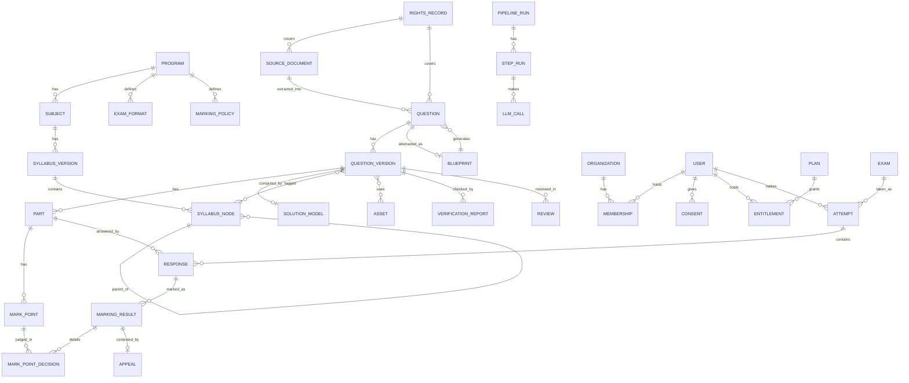
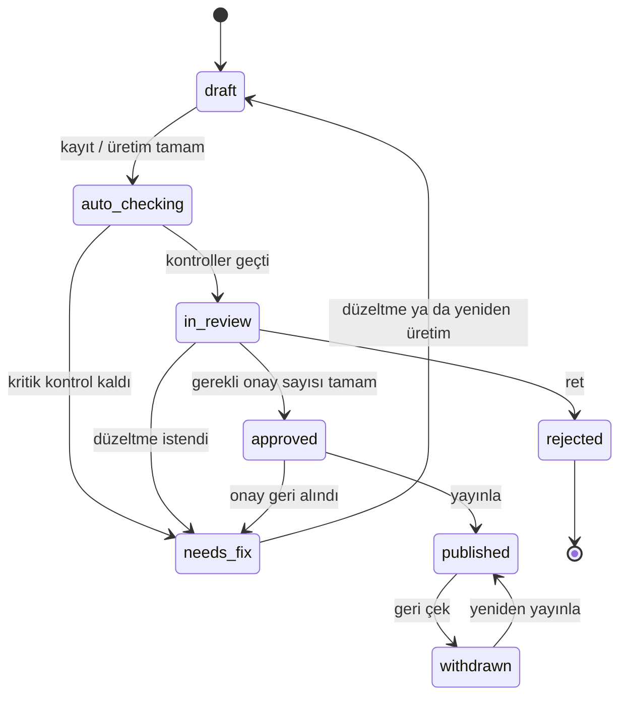
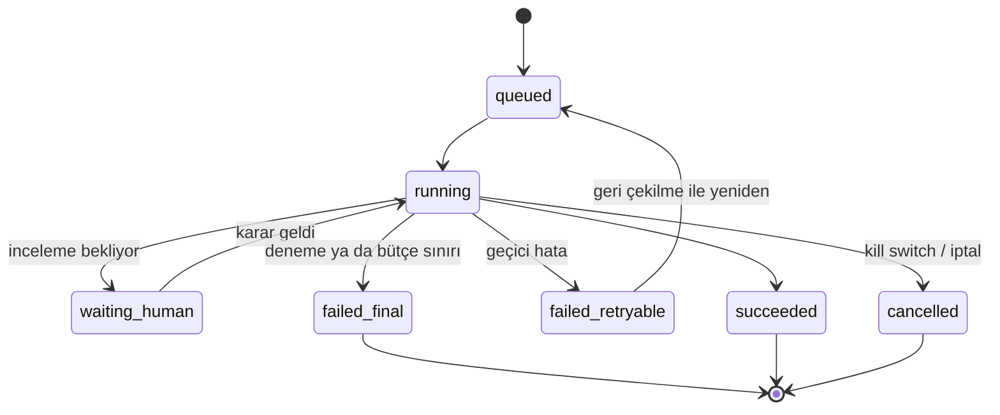

# DOMAIN_MODEL

> **Durum: ONAYLANDI** (2026-10-11, proje sahibi). Değişiklikler [DECISIONS.md](DECISIONS.md) üzerinden işlenir.
> Kavramlar, varlıklar ve yaşam döngüleri. Tablo ve şema ayrıntısı: [DATA_ARCHITECTURE.md](DATA_ARCHITECTURE.md).

## 1. Sözlük

| Terim | Anlam |
|---|---|
| Program | Bir sınav sistemi (ör. IB Diploma). Sınav biçimini ve puanlama politikasını tanımlar |
| Subject | Programdaki ders (ör. Physics) |
| SyllabusVersion | Bir dersin belirli müfredat sürümü (ör. ilk sınav 2025) |
| SyllabusNode | Müfredat ağacındaki konu ya da alt konu |
| ExamFormat | Programın sınav yapısı: bölümler/paper'lar, seviye, süre, hesap makinesi, etiket sözlüğü |
| MarkingPolicy | Programın puanlama kuralları: hata taşıma, tolerans, anlamlı basamak, ham→ölçekli puan |
| SourceDocument | Yüklenen kaynak dosya (PDF) |
| Question | Soru kimliği; içeriği sürümlerde yaşar |
| QuestionVersion | Bir sorunun değişmez sürümü |
| Part | Sürümün puanlanabilir parçası ((a), (b)(i)…). MCQ tek parçadır |
| MarkPoint | Markscheme'deki tek bir puan maddesi |
| Quantity | Soruda verilen sayısal büyüklük (değer + birim + parametre adı) |
| SolutionModel | Bildirimsel formül zinciri: parametreler, sabitler, adımlar |
| Blueprint | Bir sorunun soyut tarifi; üretimin tek girdisi |
| Origin | Sorunun kökeni: `source_original`, `generated`, `authored` |
| RightsRecord | Bir içeriğin hak sahibi ve izin kapsamı |
| Organization | Kurum. Kapalı öğrenci grubu ilk kurumdur |
| Entitlement | Bir kullanıcının neye erişebildiği (plan, program, ders) |
| Attempt | Bir öğrencinin bir deneme ya da çalışma oturumu |
| Response | Bir parçaya verilen cevap |
| MarkingResult | Bir cevabın madde bazlı puanlama sonucu |

## 2. Varlık grupları

### 2.1 Müfredat ve program

- `Program`, `Subject`, `SyllabusVersion`, `SyllabusNode`: sürümlü ağaç. Bir soru sürümü birden çok düğüme bağlanır; biri birincildir.
- `ExamFormat`: bölüm tanımları (ör. Physics için 1A, 1B, 2), seviye (SL/HL), süre, hesap makinesi izni ve programın etiket sözlüğü
  (ör. command term listesi). IB'ye özgü kavramlar sütun değil, bu kaydın verisidir. *(Dilim 2a'da yalnızca bölüm kodları ve
  komut sözcükleri var; seviye şimdilik müfredat düğümünün özniteliğidir; süre ve hesap makinesi izni uzman teyidinden sonra eklenir.)*
- `MarkingPolicy`: hata taşıma açık mı, varsayılan tolerans, anlamlı basamak kuralı, ham puandan ölçekli puana dönüşüm tablosu.
- Müfredat dışı sınıflandırılan soru silinmez; `syllabus_status = out_of_syllabus` ile saklanır (D-04).

### 2.2 İçerik

- `Question`: `origin`, `rights_record_id` (zorunlu), `syllabus_version_id` (program ve ders bundan türer). Yayınlanan sürüm durumdan bulunur.
- `QuestionVersion`: şema v1 belgesi (JSONB, doğruluk kaynağı; D-50), içerik özeti, durum. Yayınlandıktan sonra değişmez.
- `Part`, `MarkPoint`: belgeden türetilen satırlar (sıra, belge içi anahtar, etiket, puan, cevap türü; madde türü, alternatif grubu,
  yol). Gövde ve metinler belgededir; her madde 1 puandır. Çözüm modeli belgenin içindedir, ayrı tablo değildir.
  Ayrıntı: [DATA_ARCHITECTURE.md](DATA_ARCHITECTURE.md) §2.2 ve §3.5.
- `Asset`: object storage anahtarı, MIME, boyut, sha256, alt metin, üretim kaynağı (yüklenmiş / şablondan üretilmiş + parametreler).
- `Blueprint`: yapılandırılmış soyut tarif; müfredat düğümü, biçim profili sürümü, yazım yöntemi (uzman / AI önerisi + onaylayan), model ve prompt sürümü.
- `FormatProfile`: bir sınav bölümünün biçim tarifi; sürümlü, uzman onaylı, soru metni içermez (D-44).

### 2.3 Üretim ve kalite

- `PipelineRun`: bir içeriğin hattan bir geçişi; tür (ingest / generate), durum, bütçe, harcanan maliyet.
- `StepRun`: bir adımın bir denemesi; girdi özeti, çıktı, durum, hata.
- `LlmCall`: sağlayıcı, model, prompt sürümü, token, maliyet, süre, girdi özeti (önbellek anahtarı).
- `VerificationReport`: kontrol bazında sonuç (geçti / kaldı / uygulanamaz), kanıt.
- `Review`: incelemeci, karar (onay / düzeltme / ret / yeniden üret), gerekçe, süre, ikinci inceleme işareti.

### 2.4 Kullanıcı ve erişim

- `User`: identity provider kimliği, doğum tarihi, ülke, yaş bandı (türetilmiş).
- `Organization`, `Membership`: rol kuruma bağlıdır.
- `ConsentPolicy`: ülke bazlı kural (veri rızası yaşı, bağımsız satın alma yaşı, rıza yöntemi, saklama süreleri); sürümlü.
- `Consent`: kim, kimin adına, ne için, hangi yöntemle, hangi kural sürümüyle, ne zaman.
- `Plan`, `Entitlement`, `UsageQuota`: plan kapsamı program/ders bazlıdır; kota AI puanlama için sayaçtır.
- `RightsRecord`: hak sahibi, lisans referansı, izin bayrakları (gösterim, AI işleme, ticari kullanım, hangi kuruma), geçerlilik.

### 2.5 Öğrenme

- `Exam`: deneme tanımı (bölümler, süre, soru seçimi) — `ExamFormat`'tan türetilir.
- `Attempt`: kullanıcı, sınav ya da serbest çalışma, sunucudaki başlangıç ve bitiş zamanı, durum.
- `Response`: parça, soru sürümü (değişmez referans), cevap içeriği (seçenek / sayı+birim / matematik alanı LaTeX / metin / fotoğraf + onaylı çeviri).
- `MarkingResult`: yöntem (kod / AI), model ve prompt sürümü, toplam, durum.
- `MarkPointDecision`: madde, verildi mi, cevaptan kanıt, gerekçe.
- `Appeal`: öğrenci itirazı, incelemeci kararı; sonuç ölçüm setine girer.

## 3. Roller

Roller kurum kapsamındadır; platform rolleri kurumlar üstüdür.

| Rol | Kapsam | Yapabildikleri |
|---|---|---|
| `student` | Kurum ya da bireysel | Entitlement'ı kapsamındaki soruları çözer, kendi verisini görür |
| `teacher` | Kurum | Kurum öğrencilerinin sonuçlarını görür, kapalı dönemde AI puanlarını onaylar |
| `org_admin` | Kurum | Üyelik yönetir |
| `reviewer` | Platform | İçerik inceler, onaylar, itirazları karara bağlar |
| `content_admin` | Platform | Kaynak yükler, pipeline başlatır, yayını geri çeker |
| `platform_admin` | Platform | Rol, rights, plan ve kural tablolarını yönetir |

Personel rollerinde iki adımlı doğrulama zorunludur. Tam yetki tablosu: [SECURITY.md](SECURITY.md) §3.

## 4. Soru sürümü yaşam döngüsü

Kurallar:

- `published` geçişi yalnızca `approved` durumundan ve kritik kontrolü kalan rapor yokken yapılır; backend zorlar.
- Gerekli onay sayısı soru tipine bağlıdır: kodla doğrulanmış tiplerde 1, uzun açıklamalıda 2 (D-18).
- İçerik yalnızca `draft` ve `needs_fix` durumunda düzenlenir (D-55); incelemecinin geri gönderdiği sürüm yerinde düzeltilir ve her
  geçişte içerik özeti audit'e yazılır. `needs_fix` durumundaki sürüm düzenlenince `draft` olur.
- Yayınlanmış sürüm düzenlenmez. Düzeltme yeni `draft` sürüm açar; eski sürüm öğrenci kayıtları için durur. Yeni sürüm yayınlanınca
  eskisi aynı işlemde `withdrawn` olur.
- M1-G'de gerekli onay sayısı tüm sınıflar için 1'dir (D-53, geçici).
- `source_original` sorular için ek durum: `display_mode = page_crop | structured`. İnsan doğrulayana kadar `page_crop`.

## 5. Pipeline çalışması yaşam döngüsü

Her adım idempotenttir: aynı girdi özetiyle yeniden çalıştırılan adım önceki sonucu döndürür.

## 6. Değişmez kurallar (invariant)

1. Her `Question` bir `RightsRecord`'a bağlıdır.
2. `generated` her soru bir `Blueprint`'e, her Blueprint bir müfredat düğümüne ve biçim profili sürümüne bağlıdır. Blueprint bir sınav sorusuna bağlanmaz (D-45).
3. `Response` her zaman belirli bir `QuestionVersion`'a bağlanır, `Question`'a değil.
4. Parça puanlarının toplamı sürümün toplam puanına eşittir. Bir parçanın ödüllendirilebilir madde sayısı (alternatifler ve yollar bir kez sayılarak) parça puanına eşittir; "max" olarak işaretli parçada daha fazladır.
5. Sayısal cevaplı her parçanın cevabı `SolutionModel`'deki bir adıma bağlıdır. *(Şema v1'de zorlanmaz; yorumlayıcıyla birlikte gelir.)*
6. `param` taşıyan her `quantity` düğümü `SolutionModel`'deki aynı adlı parametreyle aynı değeri ve birimi taşır; çözüm modeli yoksa `param` taşınamaz. Bağlanmamış büyüklükler (ör. seçenekler, ara sonuçlar) serbesttir.
7. Her matematik düğümü kayıt anında KaTeX ile render edilebilir.
8. Reşit olmayan kullanıcının her ücretli entitlement'ı geçerli bir `Consent` kaydına dayanır (kural tablosu gerektiriyorsa).
