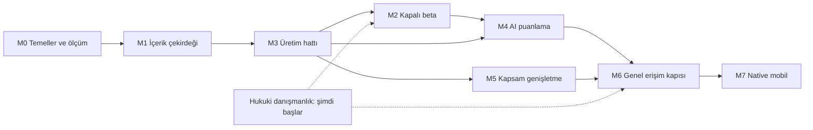

# ROADMAP

> **Durum: ONAYLANDI** (2026-10-11, proje sahibi). Değişiklikler [DECISIONS.md](DECISIONS.md) üzerinden işlenir.
> Sabit tarih yok; aşamalar kabul kriterleri karşılandıkça geçilir (D-38). Süreler kaba tahmindir.

## 1. Genel görünüm

> **2026-10-11 değişikliği (D-44, D-45, D-47):** orijinal sınav soruları öğrencilere gösterilmiyor ve üretime girdi olmuyor; yalnızca
> sahibin kişisel kitaplığında durabiliyor (M1'de küçük bir dilim). Kapalı beta üretilmiş içerikle
> yapılacağı için M3, M2'den önce gelir. Ürün hattı M2'nin içerikten bağımsız parçalarını (kimlik, kurum, soru çözme arayüzü, deneme)
> M3 ile paralel geliştirir; beta, yeterli sayıda onaylı soru olunca açılır.

> **2026-10-11 değişikliği (D-49):** 130 pilot soru hazır olduğu için M1 ile M2'nin görünen kısmı tek bir **"M1-G Görünür ürün"** aşaması
> olarak öne alındı ve M3'ten (üretim hattı) önce yapılıyor. Kapsam: soru şeması v1, veritabanı, pilot soruların içe aktarılması,
> soru gösterim bileşeni, admin inceleme ve yerinde düzenleme, öğrenci önizlemesi. Önce yerelde çalışır; web'e açılış ayrı onayla.
> Dokuz dilimin ayrıntısı: [M1-G planı](#m1-g--görünür-ürün).

İki paralel hat (M1 sonrası):

| Hat | Aşamalar |
|---|---|
| Ürün hattı | M2 → M4 (arayüz, kota) → M6 (ödeme, rıza, açık sayfalar) |
| İçerik ve AI hattı | M3 → M4 (puanlama mantığı) → M5 |

**Hukuki hat** geliştirmeden bağımsızdır ve hemen başlar. Olumsuz görüş M2'nin içeriğini ve M3'ün girdisini değiştirir; ne kadar erken
öğrenilirse o kadar az iş boşa gider.

Kaba süre: sırayla 7–9 ay; iki paralel hatla M6'ya 5–6 ay. Ekip deneyimine ve inceleme kapasitesine göre ciddi biçimde değişir.

## 2. Aşamalar

### M0 — Temeller ve ölçüm

**Amaç:** varsayımları ölçümle karara çevirmek; herkesin üzerinde çalışacağı zemini kurmak.

| İş | Çıktı |
|---|---|
| Depo, CI, üç ortam, gözlem, gizli anahtar yönetimi | Boş uygulama staging'e dağıtılıyor |
| Claude Code düzeni: `CLAUDE.md`, ajan tanımları, hook ve izinler, CODEOWNERS | [DEVELOPMENT_WORKFLOW.md](DEVELOPMENT_WORKFLOW.md) uygulanmış |
| Soru şeması v1 (Pydantic) + formül zinciri şeması + Blueprint şeması | Şema gerçek sorularla sınanmış |
| Program, sınav biçimi, puanlama politikası, müfredat ağacı (IB DP Physics) | Resmi rehberden girilmiş ve uzmanca doğrulanmış |
| Biçim profili (IB DP Physics): sınav belgelerinden ve uzmanlardan, kendi cümlelerimizle | Uzmanca onaylanmış, sürümlü profil; soru metni içermez |
| Sağlayıcı ölçümü: üç aday, rol başına | Rol ataması; no-retention koşullarının yazılı teyidi |
| Ölçüm setlerinin ilk hali (hata ekilmiş set; sentetik sorularla) | Sürümlü setler |
| Sağlayıcı seçimleri: identity (13–17 yaş koşulu belirleyici), PaaS, kuyruk kütüphanesi, matematik alanı | [TECH_STACK.md](TECH_STACK.md) güncellenmiş |
| Hukuki danışmanlık başlatılır | Sorular iletilmiş ([SECURITY.md](SECURITY.md) §4.3, §5) |

**Kabul kriteri**
- Şema v1, biçim profilindeki her soru türünü temsil ediyor; uzmanlar sentetik örnekler üzerinden doğrulamış.
- Sağlayıcı kararları ölçüm raporuyla verilmiş.
- CI: lint, tip, test, import kuralları, yetki tablosu iskeleti çalışıyor.

> Not: müfredat yapısı (beş tema, Paper 1A çoktan seçmeli, 1B veri temelli, Paper 2 kısa ve uzun cevap, SL/HL süreleri) üçüncü taraf
> kaynaklardan derlendi; resmi ders rehberinden teyit edilecek.

### M1-G — Görünür ürün

M1'in tamamını ve M2'nin öğrenci önizlemesini kapsar; aşağıdaki M1 ve M2 başlıkları bu aşamada yapılmayan kısımlar için geçerlidir.

| Dilim | İçerik |
|---|---|
| 0 ✅ | Hazırlık: belgeler, yerel PostgreSQL |
| 1 ✅ | Soru şeması v1 (Pydantic) ve testleri |
| 2a ✅ | Temel: yerel PostgreSQL, Alembic, `audit` (yalnızca eklenen kayıt), asgari `rights` (fail-closed sorgu), asgari `syllabus` (ağaç, sınav biçimi sözlüğü) (D-51) |
| 2b ✅ | `content` tabloları ve servisi: sürümler, durumlar, yayın koşulları, sözlük doğrulaması, audit (D-51, D-52, D-53) |
| 3 ✅ | KaTeX kayıt kontrolü: kapalı komut listesi, sabit sürümlü KaTeX (Node alt süreci), zorunlu `math_renders` kontrolü (D-57) |
| 4 ✅ | 130 pilot sorunun kurallı betikle şemaya çevrilmesi (`content/pilot/*.json`, çeviri raporu) ve içe aktarma komutu (D-58) |
| 5 ✅ | API (admin ve öğrenci önizlemesi), yetki katmanı, yerel geliştirme kimliği, üretilen istemci |
| 6 ✅ | Web iskeleti ve soru gösterim bileşeni; görsel regresyon |
| 7 ✅ | Admin inceleme ve yerinde düzenleme |
| 8 ✅ | Öğrenci önizlemesi |
| 9 ✅ | Web'e açılış hazırlığı (barındırma, kimlik sağlayıcısı) — ayrı onay. Uzak depo 2026-10-14'te öne alınıp açıldı (D-43) |

Durum (2026-10-21): dokuz dilimin hepsi `main`'de; deneme ortamı Render + Neon + Zitadel üzerinde açık (D-61…D-67).

**Kabul kriteri**
- 130 pilot soru veritabanında; kaynak Markdown ile otomatik karşılaştırmada **görünen metinde** fark yok (karşılaştırma alan
  türlerini ve matematik/metin ayrımını kapsamaz; [SINIRLAR.md](SINIRLAR.md) §7.1).
- Bir çoktan seçmeli, bir Paper 2 ve bir veri temelli soru masaüstü ve 375 px genişlikte sınav düzeninde görünüyor.
- Admin bir soruyu yerinde düzeltebiliyor; yayınlanmış sorunun düzeltmesi yeni sürüm açıyor, taslak ve düzeltme bekleyen sürüm yerinde
  düzenleniyor (D-55); hatalı LaTeX kaydedilemiyor.
- Onaylanmamış ya da görseli eksik soru, API doğrudan çağrılsa bile yayınlanamıyor.
- Yayınlanan soru öğrenci önizlemesinde görünüyor; öğrenci rolü admin uç noktalarına erişemiyor.

**Bilinen sınırlar:** şekil ve grafik üretimi yok (bu sorular yayınlanamaz kalır); çözüm modeli veri olarak saklanır ama yorumlayıcı
olmadığı için hesapla doğrulanmaz; hesap, deneme, analitik ve ödeme yok.

### M1 — İçerik çekirdeği

| İş | Not |
|---|---|
| `rights`, `syllabus`, `content` modülleri | Rights fail-closed ve sürüm değişmezliği testleriyle |
| Blueprint yazım ve onay ekranı | Uzman yazar ya da AI müfredattan önerir; kapsam dengesi görünümü |
| Soru gösterim bileşeni | Tüm blok tipleri; görsel regresyon seti |
| Editör (Tiptap + özel düğümler) | Kaydet-aç gidiş-dönüş testi |
| İnceleme ekranı | Aday, raporlar ve Blueprint yan yana |
| Audit log | |
| Sahibin kişisel kitaplığı (D-47) | PDF yükleme, sayfa görüntüsü olarak gösterim; yalnızca sahibin hesabı; AI adımı ve metne çevirme yok |

**Kabul kriteri**
- Elle yazılmış bir soru editörde oluşturulup inceleniyor ve yayınlanıyor.
- Doğrulanmış sorular masaüstü ve mobil genişlikte görsel regresyon testini geçiyor.
- Rights kaydı olmayan içerik kaydedilemiyor ve gösterilemiyor (test); `source_original` yolları kapalı.

### M2 — Kapalı beta (ürün hattı; M3'ten sonra açılır)

| İş | Not |
|---|---|
| `identity`, `organizations`, `entitlements` | Kurumunuz ilk Organization; yaş bandı ve ülke alanları |
| Soru listeleme ve çözme | Erişim tek politika katmanından |
| MCQ ve sayısal otomatik kontrol | Tolerans, birim, anlamlı basamak |
| Açık uçlu sorularda markscheme gösterimi | AI puanlama M4'te |
| Deneme sınavı | Süre sunucuda |
| Temel analitik | Konu bazlı doğruluk |

**Kabul kriteri**
- Kendi öğrencileriniz onaylı, üretilmiş sorularla çalışabiliyor.
- Kurum dışı hesap `source_original` içeriğe hiçbir uç noktadan erişemiyor (yetki tablosu testi).
- Uçtan uca akış 1–3 ve 9 geçiyor ([TESTING_STRATEGY.md](TESTING_STRATEGY.md) §5).
- Orijinal sınav belgeleri yalnızca sahibin hesabına dönüyor; başka hiçbir hesap ve hiçbir açık uç nokta erişemiyor (D-47; yetki tablosu testi).

### M3 — Üretim hattı (içerik ve AI hattı)

Önce MCQ (Paper 1A), sonra sayısal ve yapılandırılmış Paper 2.

| İş | Not |
|---|---|
| Formül yorumlayıcısı | Beyaz liste, alt süreç, özellik tabanlı test, mutation |
| Blueprint önerisi (müfredattan) ve kontrolü | Model sınav sorusu görmez |
| `generation` | `content` import yasağıyla |
| Kod kontrolleri | [AI_PIPELINE.md](AI_PIPELINE.md) §6 tablosu |
| Kör çözüm, eleştirmen | Sağlayıcı ayrımı |
| Benzerlik | Embedding + metin örtüşmesi; eşik kalibrasyonu |
| İnceleme iş akışı | 1 / 2 incelemeci kuralı, ikinci inceleme örneklemi, iş dağıtımı |
| Yayın ve geri çekme | Lineage ile toplu geri çekme |
| Prompt sürümleme ve ölçüm kapısı | |

**Kabul kriteri**
- Hata ekilmiş sette sayısal ve birim hataları hedeflenen oranda yakalanıyor (hedef M0'da konur).
- Kritik kontrolü kalan aday, API doğrudan çağrılsa bile yayınlanamıyor.
- Her üretilmiş soru Blueprint'e, müfredat düğümüne ve biçim profili sürümüne bağlı; inceleme formunda ezber sorusu zorunlu.
- İncelemeci onay oranı ve yayınlanan soru başı toplam maliyet (LLM + inceleme süresi) ölçülüyor.
- Formül zincirine sığan soru oranı ölçülmüş; sığmayanlar için karar verilmiş.

### M4 — AI puanlama

| İş | Not |
|---|---|
| Görsel matematik alanı ile yazılı cevap | Mobil tarayıcıda sınanmış |
| Madde bazlı puanlama + hata taşıma | Toplamı kod hesaplar |
| Fotoğraf: yükleme, çeviri, öğrenci onayı | İmzalı erişim, meta veri temizliği |
| İtiraz akışı | Sonuçlar ölçüm setine akar |
| Kota | Aylık tavan |
| Öğretmen onay ekranı | Kapalı dönem ölçümü |

**Kabul kriteri**
- Puanlama setinde öğretmenle uyum, belirlenen eşiğin üstünde (eşik bu aşamanın başında, ilk ölçümden sonra konur).
- Cevap başı maliyet yazılı ve fotoğraf için ölçülmüş; kota buna göre belirlenmiş.
- Enjeksiyon testleri: cevap metni puanı yükseltemiyor.

### M5 — Kapsam genişletme

- Paper 1B: veri tabloları, grafikler, belirsizlik; grafikler veriden üretilir.
- Diyagram şablon kütüphanesi: konulara göre öncelik sırasıyla.
- Uzun açıklamalı sorular: iki incelemeci.
- Abonelik 2 içerikleri: detaylı çözümler ve konu özetleri; önceden üretilir, incelemeden geçer.
- Gerekirse: formül zincirine sığmayan tipler için sınırlı, izole Python yolu.

**Kabul kriteri:** her yeni tip için şema, doğrulama kuralı ve inceleme kuralı tanımlı; ilgili ölçüm seti genişletilmiş ve hedefler tutuyor.

### M6 — Genel erişim kapısı

| Kapı | Ölçüt |
|---|---|
| ⚖️ Hukuki görüş | [SECURITY.md](SECURITY.md) §4.3 sorularına yazılı yanıt; gereken değişiklikler uygulanmış |
| ⚖️ Yaş ve rıza | Açılış ülkeleri için `ConsentPolicy` satırları danışmanca doldurulmuş; veli-öder akışı çalışıyor |
| Ödeme | Üç kademe, abonelik yaşam döngüsü, kota; webhook idempotent |
| Güvenlik | Bağımsız sızma testi ve dış kod denetimi; kritik bulgu yok |
| Gizlilik | Veri indirme ve silme akışları; gizlilik bildirimi |
| Puanlama kalitesi | M4 eşiği kapalı dönem verisiyle hâlâ tutuyor |
| İçerik | Açılış için yeterli sayıda yayınlanmış soru (sayı ürün kararı) |
| Açık sayfalar | Ücretsiz sorular ve konu sayfaları; erişilebilirlik denetimi (WCAG 2.2 AA) |
| İşletme | Uyarılar, yedekten geri yükleme tatbikatı, olay müdahale planı |

### M7 — Native mobil

- Karar: Expo ya da Capacitor; mobil tarayıcı kullanım verisiyle.
- Fotoğrafla cevap native kamerayla.
- **Kabul kriteri:** görsel regresyon seti web ile aynı sonucu veriyor; mağaza incelemesinden geçmiş.

### Sonrası — Genişleme

1. Aynı programda ikinci ders (ör. Mathematics): yeni doğrulayıcılar, şablonlar, ölçüm setleri. Soyutlamalar burada, iki gerçek örnekten çıkarılır.
2. İkinci sınav kurumu: sınav biçimi, puanlama politikası, **ayrı hukuki dosya**.
3. Kabul ve yetenek sınavları (SAT/ACT, ESAT, TMUA): ölçekli puan, uyarlanır deneme.

Her yeni ders için kabul kriteri şu soruyu yanıtlar: **"Bu derste doğruluğu neyle garanti ediyoruz?"** (R-03)

## 3. Her aşamanın sonunda

- Mimari uygunluk incelemesi: kod `docs/` ile karşılaştırılır; sapma düzeltilir ya da [DECISIONS.md](DECISIONS.md)'e yazılır.
- Kritik modüllerde mutation testing sonucu gözden geçirilir.
- Risk kaydı güncellenir.
- Belgeler güncellenir; belge ile kod çelişiyorsa aşama kapanmaz.
